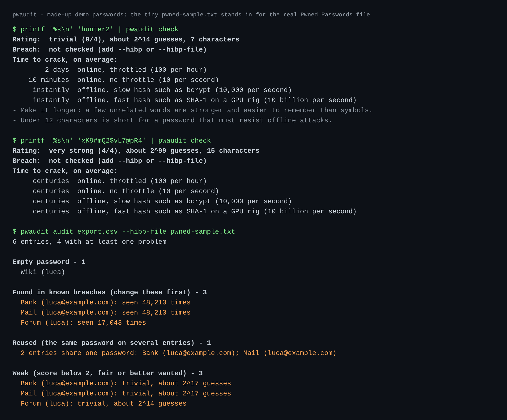

# pwaudit - offline password auditor

[](https://github.com/TexAlphaWolf/sec-password-audit/actions/workflows/ci.yml)
[](https://github.com/TexAlphaWolf/sec-password-audit/actions/workflows/codeql.yml)
[](https://github.com/TexAlphaWolf/sec-password-audit/actions/workflows/live.yml)


Answers three questions about your passwords, without sending any of them anywhere:

1. **How guessable is it?** A pattern-aware estimate (common passwords, leetspeak, keyboard walks, sequences, dates), not "8 characters with a symbol = strong".
2. **Is it reused?** Across a whole password-manager export.
3. **Has it been in a breach?** With **k-anonymity**: only 5 hex characters of the SHA-1 leave the machine (online), or nothing at all (offline, against the downloaded Pwned Passwords file).

Standard library only: no runtime dependencies. Passwords are **never accepted as arguments** (they would land in your shell history and the process list) and **never printed**.



*Made-up demo passwords. The tiny `pwned-sample.txt` stands in for the real Pwned Passwords file so the picture can be reproduced offline.*

## Quick start

```bash
pip install .

# One password: typed (hidden) or piped
pwaudit check
printf '%s\n' 'hunter2' | pwaudit check --hibp          # online, k-anonymity

# A password-manager export (Bitwarden, Chrome, Firefox and similar CSV exports)
pwaudit audit export.csv --hibp-file pwned-passwords-sha1-ordered-by-hash.txt
pwaudit audit export.csv --hibp --format md > report.md
```

Delete the export when you are done: it contains every password in clear.

- **Offline breach file:** download "Pwned Passwords, SHA-1, ordered by hash" from [haveibeenpwned.com/Passwords](https://haveibeenpwned.com/Passwords) (about 20 GB). It is searched by binary search without being loaded into memory.
- **Docker, no network at all:** `docker build -t pwaudit .` then `printf '%s\n' 'hunter2' | docker run --rm -i --network none pwaudit check`, or mount the export read-only: `docker run --rm --network none -v "$PWD/export.csv:/data/export.csv:ro" pwaudit audit export.csv`.

## What makes it different from a "password strength meter"

| | pwaudit |
|---|---|
| Estimate | the cheapest way an attacker's tool would build the password from known pieces; `P@ssw0rd` is trivial, a 4-word passphrase is strong ([how it works](docs/estimator.md)) |
| Honest scale | 0-4 rating plus the time to crack in four scenarios: online throttled, online, offline slow hash, offline fast hash |
| Leaks | k-anonymity: the password and its full hash never leave the machine; `Add-Padding` hides how many suffixes matched; one request per distinct prefix, never per row |
| Failure is not "clean" | a failed breach lookup is reported as *not checked* (exit code 1), never as "not found" |
| Reuse | found with a per-run keyed hash (HMAC-SHA-256 with a random key), so nothing reusable is kept |
| Reports | name entries by label only; tests assert that no password appears in any output format |
| Context | `--context luca --context examplebank`: a password containing the user or site name is the first thing an attacker tries |
| NIST-style | judged on length and guessability and breach status, not on "must contain a symbol" |

## Commands

```
pwaudit check  [--hibp | --hibp-file FILE] [--context WORD]... [--wordlist FILE] [--json]
               [--min-score 0-4] [--min-length 12] [--exit-code]
pwaudit audit  FILE [--hibp | --hibp-file FILE] [--format text|md|json] [--wordlist FILE]
               [--min-score 2] [--min-length 12] [--exit-code]
```

`--exit-code` returns 3 when there is a problem, so a script can gate on it; exit code 1 means the breach lookup failed, 2 means a usage or file error.

`--wordlist` adds a dictionary, most common first (for example a leaked-password list you already have). The built-in dictionary is small on purpose; see [limitations](docs/limitations.md).

## Results

All numbers below were measured; reproduce them with `python tools/evaluate.py --n 2000 --seed 7`.

| Check | Result |
|---|---|
| Tests | 106 (stand-in HIBP server, binary search over generated hash files with LF and CRLF, real-process pipe test, every export layout), 97% line+branch coverage, strict mypy, ruff |
| Runs on | Python 3.11, 3.12, 3.13, 3.14 on Linux, 3.14 on Windows; the Docker image (non-root, read-only filesystem, `--network none`) |
| Real API | `tools/live_check.py` (weekly workflow and on demand) asks the real Pwned Passwords API about `password` and `123456` and a random password, and checks the padding is handled |
| **Never overestimates a random password** | 24,000 uniformly random passwords (4 alphabets x 3 lengths x 2,000): estimates above the true search space: **0** (mean estimate 1-6 bits under the true value: it is conservative) |
| Patterned passwords rated weak (score 0 or 1) | word + digits 96.8%, keyboard walks 100%, dates 100%, leetspeak 98.7% |
| Passphrases of random common words | 2 words: weak (28 bits); 3 words: 99.7% rated 3+ (53 bits); 4 words: 100% rated 3+, 99.6% very strong (76 bits) |
| Speed | about 940 passwords/s per thread (14 random characters): a 1,000-entry export takes about a second |

The patterned rows draw their words from the estimator's own dictionary, so they show that the pattern logic works *when the word is known*. How often a real user's word is known depends on the dictionary: use `--wordlist` with a large list, and rely on the breach check, which does not depend on guessing at all.

## Limits you should know

- An estimate models *typical cracking tools*; it is not a proof of strength. A password that is "very strong" here can still be stolen by a keylogger or phished.
- The built-in dictionary has about 1,000 entries. A password built from a word it does not know is scored as random characters, which **overestimates** its strength. Breach checking and `--wordlist` are the remedies.
- Python cannot reliably erase a string from memory. Do not run it on a shared or untrusted machine.

More: [how the estimator works](docs/estimator.md) · [security notes](docs/security.md) · [limitations](docs/limitations.md) · [changelog](CHANGELOG.md)

## Development

```bash
pip install -e ".[dev]"
ruff check . && ruff format --check . && mypy && pytest --cov
python tools/evaluate.py --n 2000 --seed 7     # calibration
python tools/live_check.py                     # the real API (needs internet)
```

MIT licensed. Breach data: [Have I Been Pwned](https://haveibeenpwned.com/) Pwned Passwords by Troy Hunt; this project is not affiliated with or endorsed by it. The estimator follows the approach of zxcvbn (Wheeler, USENIX Security 2016).
